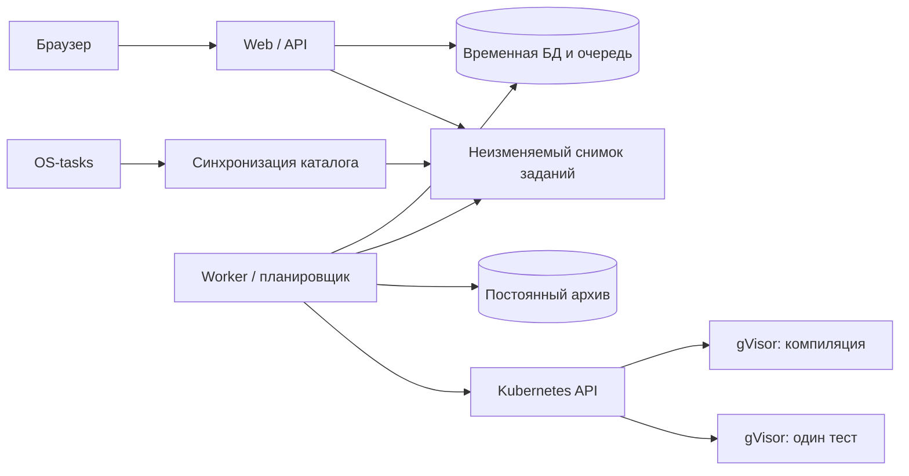

# Архитектура

## Статус и границы

Это спецификация и структура будущей системы, не работающий сервис. Исходники содержат только описания назначения; контейнерные и Kubernetes-файлы — комментарии. Нет серверных обработчиков, миграций, запуска кода, установленных зависимостей или готовой защиты. Не принимать реальные посылки до выполнения критериев [плана реализации](implementation.md).

## Технологии и процессы

- Python 3.12+, FastAPI, Uvicorn, Jinja2; обычные HTML-страницы, небольшой JavaScript для отправки файла и опроса статуса. Отдельный SPA/Node.js не нужен.
- CommonMark через markdown-it-py, HTML-санитизация через nh3. HTML из задания не исполняется.
- PostgreSQL, psycopg 3: две базы с разными ролями и жизненными циклами — `checker_transient` и `checker_archive`. Дополнительный брокер очереди не нужен.
- Kubernetes API и gVisor (`RuntimeClass: gvisor`, handler `runsc`): отдельный Pod для компиляции и отдельный Pod для каждого теста. Компиляция тоже обрабатывает недоверенный ввод.
- Один образ приложения, разные процессы `web`, `worker`, `catalog-sync`; отдельные образы компилятора и запуска. Версии зависимостей и образы по digest фиксирует реализующий агент в lock-файле и deploy-конфигурации.

## Границы модулей

| Каталог / файл | Ответственность |
| --- | --- |
| `src/os_sol_checker/domain/` | Типы задания, посылки и результата; состояния и чистые политики идентичности/сравнения. Без HTTP, SQL и Kubernetes. |
| `application/catalog.py` | Публикация и чтение согласованного каталога. |
| `application/submissions.py` | Приём посылки, проверка кэша, создание записи и задания очереди. |
| `application/judging.py` | Компиляция, последовательные тесты, первый сбой, терминальный результат. |
| `application/archive.py` | Идемпотентное сохранение успешного исходника и факта успеха. |
| `application/sessions.py` | Имя, группа, принадлежность посылок и последняя посылка по задаче. |
| `ports/` | Контракты каталога, временного хранилища, архива, очереди и песочницы. |
| `adapters/catalog/` | Безопасное получение Git-снимка, парсинг структуры/Markdown и отпечаток tests. |
| `adapters/postgres/` | Реализации хранилищ, транзакций и очереди. |
| `adapters/kubernetes/` | Создание, обмен данными, наблюдение и гарантированная уборка sandbox Pod. |
| `worker/` | Единственный активный планировщик, слоты, восстановление после сбоев. |
| `web/` | HTTP, cookies, CSRF, шаблоны, статические ресурсы; без запуска процессов. |
| `sandbox/` | Минимальные входные программы compile/run stage; выполняются только внутри gVisor. |
| `migrations/transient/`, `migrations/archive/` | Независимые миграции двух баз. |
| `deploy/` | Контейнеры и конфигурация кластера; не код бизнес-логики. |

Не создавать отдельный микросервис для каждого модуля. Зависимости направлены из адаптеров в application/domain; домен не импортирует адаптеры. Интерфейсы выделены там, где пользователь ожидает смену алгоритма: `SourceIdentity`, `TestsFingerprint`, `OutputComparator`, `AcceptedSolutionStore`, `SandboxBackend`.

## Контракты портов

Имена ниже — будущие публичные интерфейсы, а не уже существующие символы. DTO определяются в `domain/models.py`; I/O-порты асинхронные, чистые политики синхронные.

| Порт | Операции и инварианты |
| --- | --- |
| `CatalogRepository` | `current()`, `get_task(snapshot_id, task_id)`, `publish(snapshot)`; запрос получает один неизменяемый снимок целиком. |
| `SourceIdentity` | `identify(raw_bytes) -> (sha256, byte_size)`; исходные байты не нормализуются. Другая эвристика позднее не меняет формат хранимого оригинала. |
| `TestsFingerprint` | `calculate(tree) -> digest`; включает все каталоги tests, пути, типы записей и байты, а не mtimes. |
| `SubmissionStore` | Атомарный приём посылки + last-submission + запись очереди; смена поколения и чтение кэша транзакционно согласованы. |
| `ResultCache` | `get(cache_key)`, `put_if_current(generation, key, result)`; только окончательные результаты проверки, не инфраструктурные ошибки. |
| `Queue` | `claim()`, `finish()`, `invalidate_generation()`; очередь и посылка в одной временной БД. |
| `AcceptedSolutionStore` | `record_success(identity, source, task_id, context, submitter)`; атомарная уникальность blob и связи с задачей. |
| `OutputComparator` | `compare(expected_bytes, actual_bytes) -> match / bounded_diff`; начальная политика — строгое побайтовое равенство. |
| `SandboxBackend` | `compile(source, policy, deadline) -> artifact / failure`, `run(artifact, stdin, policy, deadline) -> outcome`, `destroy(handle)`; лимиты действуют и при потере связи с worker. |
| `SessionStore` | Случайная сессия, профиль, принадлежность посылок, last-submission; UUID посылки сам по себе не даёт доступ. |

`SandboxOutcome` содержит exit code/signal, причину принудительной остановки, wall time и ограниченные stdout/stderr. Нельзя определять причину остановки только по тексту stderr. Контекст проверки: commit каталога, tests digest, generation, compiler/runtime image digest, flags digest, limits и comparator version. Он неизменяем после приёма.

Архив хранит исторический факт успеха в конкретном контексте, поэтому поздний commit старой проверки допустим только со старым контекстом и никогда не становится текущим результатом. Общая транзакция двух БД не нужна. `accepted` публикуется после подтверждения архива и повторной проверки generation в transient; смена tests не ждёт доступности архива.

## Настройки по умолчанию

| Настройка | Значение | Смысл |
| --- | --- | --- |
| `MAX_SOURCE_BYTES` | 102400 | 100 КиБ; ровно это число разрешено. |
| `MAX_REQUEST_BYTES` | 131072 | Весь multipart body, включая служебные поля. |
| `MAX_CONCURRENT_SANDBOXES` | 4 | Глобальный предел, не на реплику API. |
| `QUEUE_CAPACITY` | 1000 | Максимум ожидающих уникальных jobs; followers не занимают новое место. |
| `COMPILE_TIMEOUT_SECONDS` | 10 | Wall time процесса компиляции. |
| `RUN_TIMEOUT_SECONDS` | 2 | Wall time одного теста. |
| `SUBMISSION_DEADLINE_SECONDS` | 60 | Всё активное выполнение, включая создание и уборку Pod; ожидание очереди не входит. |
| `SANDBOX_MEMORY_MIB` | 256 | Предел памяти одного stage, включая служебную программу. |
| `SANDBOX_PIDS_LIMIT` | 64 | Предел процессов всего sandbox cgroup; проверяется на узле. |
| `SANDBOX_TMP_MIB` | 32 | Ограниченный memory-backed scratch. |
| `MAX_OUTPUT_BYTES` | 65536 | Общий stdout + stderr одного stage; превышение останавливает stage. |
| `MAX_ARTIFACT_BYTES` | 1048576 | Предел скомпилированного файла; отдельный бинарный канал. |
| `TRANSIENT_TTL_HOURS` | 24 | Срок хранения терминальных посылок и их исходников. |
| `SESSION_TTL_DAYS` | 30 | Профиль и ссылки на последние посылки. |
| `CATALOG_POLL_SECONDS` | 60 | Период проверки upstream. |

Изменение влияющих на проверку настроек создаёт новый `judge_policy_digest`; старые кэш-результаты не подходят. Проверять настройки при старте: положительные значения, compile/run timeout не выше общего deadline, общий deadline не выше 60 секунд. Секреты не имеют значений по умолчанию.

`PUBLIC_ORIGIN` (точный HTTPS origin интерфейса) и `CSRF_SECRET` (криптографически случайный серверный секрет) обязательны без defaults, как и обе database URL и image digests. Секреты передаются только окружением/Secret, не в файлах репозитория.

## Связанные спецификации

- [Формат каталога, Markdown и обновления](catalog.md).
- [Посылки, БД, cookies, HTTP и интерфейс](submissions.md).
- [Песочница, ограничения и развёртывание](security.md).
- [Порядок реализации и проверка готовности](implementation.md).
